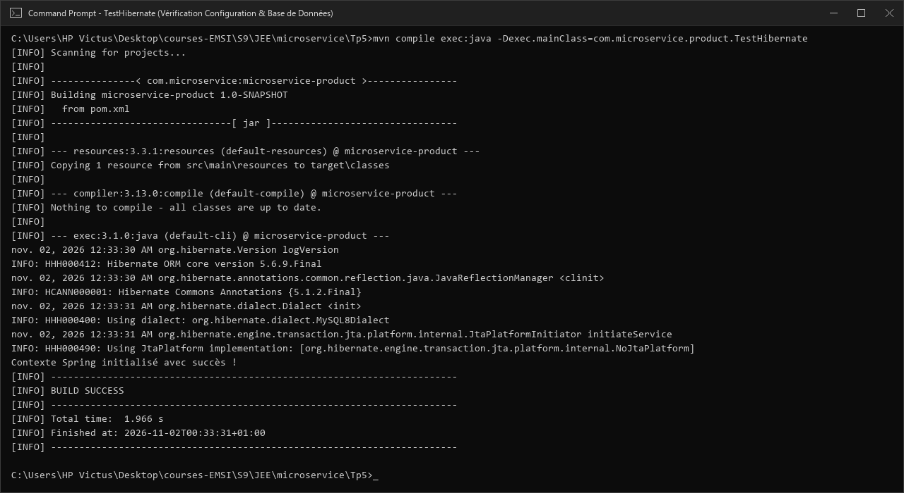
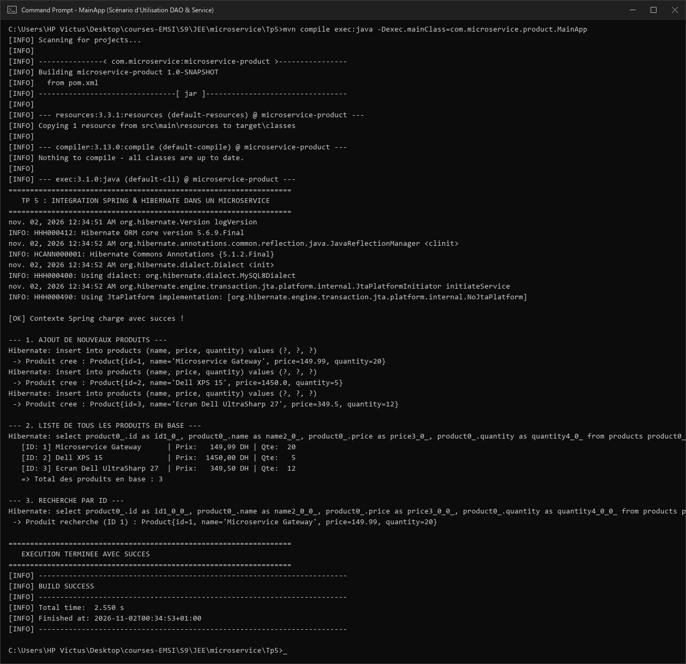
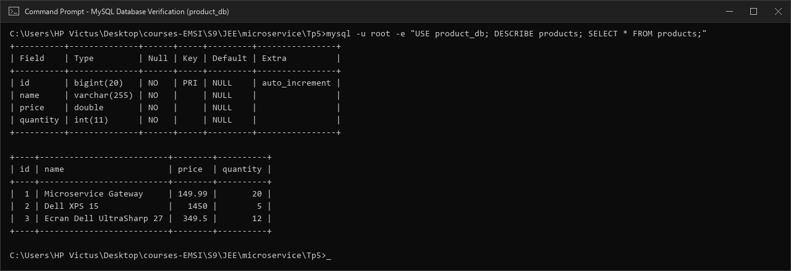

# TP 5 : Intégration de Spring et Hibernate dans une Architecture Microservices

Ce projet illustre l'intégration de **Spring Framework** (IoC, DI, ORM, Transactions) et d'**Hibernate** (JPA) dans un microservice de gestion de catalogue produit (**`microservice-product`**).

---

## 🎯 Objectifs & Prérequis

- **Objectifs** : Maîtriser l'intégration Spring ORM + Hibernate, le pattern **DAO Générique**, la configuration 100% Java (`@Configuration`), et la gestion transactionnelle déclarative (`@Transactional`).
- **Prérequis** : JDK 1.8+, Maven, SGBD MySQL (ex. via XAMPP sur le port `3306`), base de données `product_db`.

---

## 🏗️ Structure du Projet

```text
Tp5/
├── pom.xml                                      # Dépendances Spring 5, Hibernate 5 & MySQL Connector
├── README.md                                    # Documentation du TP 5
├── screenshots/                                 # Captures réelles d'exécution Windows CMD
│   ├── 01_test_hibernate_cmd.png               # Vérification SessionFactory & Base de données
│   ├── 02_main_app_execution_cmd.png            # Exécution de MainApp (Ajout & Consultation)
│   └── 03_mysql_database_verification_cmd.png   # Vérification des tables et données dans MySQL
└── src/
    └── main/
        ├── java/com/microservice/product/
        │   ├── MainApp.java                     # Scénario d'utilisation complet (CRUD)
        │   ├── TestHibernate.java               # Test d'initialisation Spring & DB
        │   ├── config/
        │   │   ├── AppConfig.java               # Configuration centrale (@ComponentScan)
        │   │   ├── HibernateConfig.java         # Déclaration DataSource & LocalSessionFactoryBean
        │   │   └── TransactionConfig.java       # Activation des transactions (@EnableTransactionManagement)
        │   ├── dao/
        │   │   ├── IDao.java                    # Interface DAO générique IDao<T>
        │   │   └── ProductDaoImpl.java          # Implémentation DAO avec SessionFactory
        │   ├── entity/
        │   │   └── Product.java                 # Entité persistante (@Entity, @Table)
        │   └── service/
        │       ├── ProductService.java          # Contrat de service métier
        │       └── ProductServiceImpl.java      # Logique métier transactionnelle (@Transactional)
        └── resources/
            └── application.properties           # Paramètres de connexion JDBC et Hibernate
```

---

## ⚙️ Étapes de Réalisation (Steps 1 à 12)

| Étape | Composant / Fichier | Rôle & Points Clés |
| :--- | :--- | :--- |
| **Step 1** | *Introduction* | Séparation claire des responsabilités (Présentation, Service, DAO). |
| **Step 2** | [`pom.xml`](pom.xml) | Dépendances `spring-context` (5.3.20), `spring-orm`, `hibernate-core` (5.6.9.Final), et `mysql-connector-java`. |
| **Step 3** | [`application.properties`](src/main/resources/application.properties) | Configuration JDBC (`url`, `username`, `password`) et Hibernate (`MySQL8Dialect`, `hbm2ddl.auto=update`). |
| **Step 4** | [`Product.java`](src/main/java/com/microservice/product/entity/Product.java) | Entité JPA avec `@Id`, `@GeneratedValue(IDENTITY)`, champs `name`, `price` et `quantity`. |
| **Step 5** | [`IDao.java`](src/main/java/com/microservice/product/dao/IDao.java) | Interface générique `IDao<T>` définissant les opérations CRUD : `save`, `update`, `delete`, `findById`, `findAll`. |
| **Step 6** | [`ProductDaoImpl.java`](src/main/java/com/microservice/product/dao/ProductDaoImpl.java) | DAO `@Repository` utilisant `sessionFactory.getCurrentSession()` pour exécuter les opérations Hibernate/HQL. |
| **Step 7** | [`HibernateConfig.java`](src/main/java/com/microservice/product/config/HibernateConfig.java) | Configuration `@PropertySource` déclarant les beans `DriverManagerDataSource` et `LocalSessionFactoryBean`. |
| **Step 8** | [`TransactionConfig.java`](src/main/java/com/microservice/product/config/TransactionConfig.java) | `@EnableTransactionManagement` avec déclaration du bean `HibernateTransactionManager`. |
| **Step 9** | [`ProductService(Impl).java`](src/main/java/com/microservice/product/service/ProductServiceImpl.java) | Couche métier isolée avec `@Service`, injection du DAO et transactions `@Transactional`. |
| **Step 10** | [`AppConfig.java`](src/main/java/com/microservice/product/config/AppConfig.java) | Configuration `@ComponentScan("com.microservice.product")` activant la détection des composants. |
| **Step 11** | [`TestHibernate.java`](src/main/java/com/microservice/product/TestHibernate.java) | Test du démarrage du conteneur Spring et validation de la création automatique des tables. |
| **Step 12** | [`MainApp.java`](src/main/java/com/microservice/product/MainApp.java) | Scénario complet : ajout de produits, affichage de la liste et recherche par ID. |

---

## 📸 Résultats & Captures d'Exécution Réelles (Windows CMD)

### 1. Vérification de la Configuration & Base de Données (Step 11)

Lancement du test d'initialisation via `TestHibernate` :

```cmd
mvn compile exec:java -Dexec.mainClass=com.microservice.product.TestHibernate
```



- **Validation** : Initialisation d'Hibernate 5.6.9, connexion au dialecte MySQL 8, et confirmation du chargement du contexte Spring.

---

### 2. Scénario d'Utilisation DAO & Service (Step 12)

Lancement du flux applicatif complet via `MainApp` :

```cmd
mvn compile exec:java -Dexec.mainClass=com.microservice.product.MainApp
```



- **Validation** :
  1. Génération des requêtes SQL `INSERT` par Hibernate et assignation des identifiants auto-incrémentés.
  2. Récupération globale via requête `SELECT` HQL et affichage formaté du catalogue.
  3. Recherche unitaire ciblée par clé primaire via `findById()`.

---

### 3. Vérification de la Persistance dans MySQL

Vérification directe de la table générée et des lignes insérées dans `product_db` :

```cmd
mysql -u root -e "USE product_db; DESCRIBE products; SELECT * FROM products;"
```



- **Structure de la table `products`** : `id` (bigint, PK auto_increment), `name` (varchar), `price` (double), `quantity` (int).
- **Données persistées** : Les 3 produits insérés sont confirmés en base de données avec intégrité transactionnelle.

---

## 🚀 Guide d'Exécution

```cmd
# 1. Se positionner dans le dossier du projet
cd "C:\Users\HP Victus\Desktop\courses-EMSI\S9\JEE\microservice\Tp5"

# 2. Compiler le projet avec Maven
mvn clean compile

# 3. Exécuter le test de configuration (Step 11)
mvn exec:java -Dexec.mainClass=com.microservice.product.TestHibernate

# 4. Exécuter l'application principale (Step 12)
mvn exec:java -Dexec.mainClass=com.microservice.product.MainApp
```
